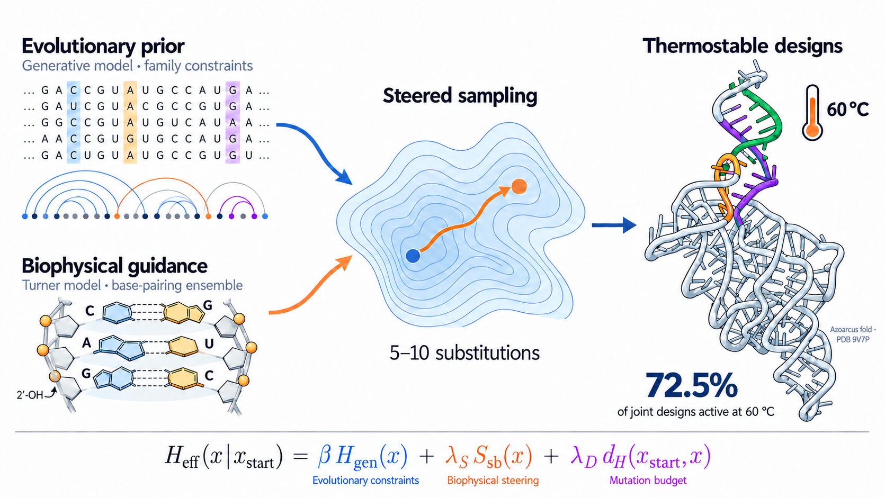

# Biophysics-informed generative models for thermostable ribozymes

[](https://doi.org/10.5281/zenodo.24418219)



Code and data of *"Biophysics-informed generative models improve activity and thermostability of designed
ribozymes"*. Starting from Azoarcus group I intron variants that self-splice at 37 °C but not at 60 °C, we sample
variants with 5–10 additional substitutions from an effective Hamiltonian that combines

- a DCA (Potts) model of the intron family, $H_{\mathrm{gen}}$, which keeps the sequences functionally plausible, and
- a structure-based potential from the Turner nearest-neighbour model (ViennaRNA),
  $S_{\mathrm{sb}} = -\sum_{(i,j) \in \mathrm{consensus}} p_{ij}$, the (negative) expected number of consensus
  base pairs at equilibrium,

$$H_{\mathrm{eff}}(x \mid x_{\mathrm{start}}) = \beta H_{\mathrm{gen}}(x) + \lambda_S S_{\mathrm{sb}}(x) + \lambda_D d_H(x_{\mathrm{start}}, x).$$

Both terms are needed to recover activity at 60 °C (hit rate 72.5% for the jointly optimised designs versus 7.8% and
0.4% for either term alone).

## Repository layout

```
data/        input data (see data/README.md)
thermodca/      small python package: DCA model, Turner-model scores, design sampler, plotting style
scripts/     numbered scripts that reproduce the pipeline (below)
results/     tables, figures and design outputs written by the scripts
run_all.sh   runs the whole analysis
```

## Installation

The environment is managed with [uv](https://docs.astral.sh/uv/):

```bash
uv sync                          # creates .venv from pyproject.toml / uv.lock
uv run python scripts/01_score_sequences.py
```

adabmDCA 2.0 is installed from the `develop` branch of <https://github.com/spqb/adabmDCApy> (see
`[tool.uv.sources]` in `pyproject.toml`; switch to `main` once it is released there). Figures use LaTeX
(`latex`, `dvipng` and the Computer Modern fonts must be installed on the system). A GPU is optional (it only
makes step 2 fast).

## Pipeline

| script | content | paper |
|---|---|---|
| `01_score_sequences.py` | $H_{\mathrm{gen}}$, $S_{\mathrm{sb}}$ (37 °C, 60 °C), $\Delta G$ of the consensus structure for the Lambert et al. data and for all tested sequences | – |
| `02_design_mutants.py` | samples new designs from $H_{\mathrm{eff}}$ (multi-step Monte Carlo: Gibbs sweeps for the fast terms, Metropolis on $S_{\mathrm{sb}}$) and selects them by region (Table I) | Sec. III.E, IV.C |
| `04_figures_lambert_data.py` | $S_{\mathrm{sb}}$ vs $H_{\mathrm{gen}}$ and activity at 60 °C; activity vs distance from Azoarcus | Fig. 2, SI Figs. 2–3, SI Fig. 7 |
| `05_figures_experiment.py` | phase space of start 5, activity violins, $\Delta$ activity, overlap/noise controls | Figs. 3–5, SI Figs. 4, 6 |
| `06_tables.py` | hit rates, activity quartiles, $\Delta\Delta G$, $\Delta$(H-bonds), pool statistics | Table II, SI Tables II–IV |
| `07_md_candidates.py` | best/worst design per start (for MD), FORNA input files | Appendix C |
| `08_mutation_analysis.py` | per-mutation effects, epistasis, base-pair content (exploratory) | not in the paper |
| `09_mnist_toy.py` | MNIST 0→8 toy example | Fig. 1 |

Run everything with `./run_all.sh` (it calls `uv run`) or run a single script with `uv run python scripts/<name>.py`; each script has a docstring describing its inputs and outputs. Step 3 does not
exist: the high-throughput measurements are already in `data/experiment.csv`.

## Conventions

- **Start sequences** are the ten variants of Lambert et al. that we mutate (`start_id` 1–10). Only the Azoarcus
  sequence is a "wild type".
- **$S_{\mathrm{sb}}$ is negative**: $S_{\mathrm{sb}} = -\sum p_{ij}$; low (more negative) is favourable.
- **Groups** follow the paper: `lowDCA_lowSB` = $\downarrow H_{\mathrm{gen}} \downarrow S_{\mathrm{sb}}$ (joint),
  `lowDCA_highSB` = $\downarrow H_{\mathrm{gen}} \uparrow S_{\mathrm{sb}}$ (evolutionary score only),
  `highDCA_lowSB` = $\uparrow H_{\mathrm{gen}} \downarrow S_{\mathrm{sb}}$ (structure score only), plus the `noise`
  and `overlap` controls.
- **Activity** is $\log_{10}(f_{\mathrm{sel}} / f_{\mathrm{ref}})$. It is normalised by subtracting, for each
  temperature, the mean over the detected overlap-group sequences; a *hit* has normalised activity $\ge -1$.
  In `data/experiment.csv` a sequence with
  control reads but no reacted read is **undetected**, activity `-inf`: it is inactive and is kept in every count,
  quantile and hit rate (the finite positions used for it in Figs. 4 and 5 are display conventions only). A sequence
  with no control read is **missing**, activity empty (`NaN`): it is left out of every statistic (one noise control
  at 60 °C). `data/lambert_dataset.csv` follows the same activity convention, with its read counts; there an empty 60 °C
  activity can also mean that the variant was not tested at 60 °C.
- Sequences have 197 nt: `GUG` + 193-nt aligned intron + `G`. The DCA model acts on the 193 central nucleotides and
  uses the adabmDCA 2.0 alphabet `-ACGU` (gap first).

The sampling parameters of the designs are in [docs/design_parameters.md](docs/design_parameters.md).

## Data availability

Everything in this repository is also archived on Zenodo, together with the files and the code that are not
tracked here: <https://doi.org/10.5281/zenodo.24418219>. The archive is what is needed to reproduce the figures of
the paper and the molecular dynamics analyses of Appendix C.

## Reference

Lambert et al., *Exploring the space of self-reproducing ribozymes using generative models*,
Nat. Commun. 16, 7836 (2025).
